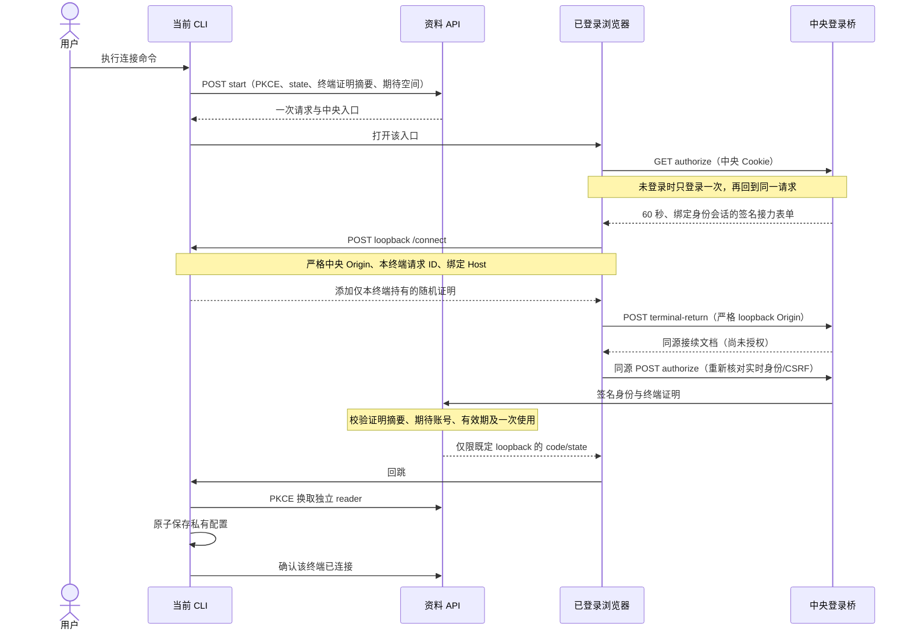

# 终端连接协议 v2（0.4.2 候选）

插件的 writer 与终端的 reader 是独立凭据：浏览器可以保存和上传，终端仅可读取。两套凭据有必要；两次输入身份和额外的只读确认没有必要。

现有实现中，`chrome.identity.launchWebAuthFlow` 与 CLI 的系统默认浏览器都会到同一中央身份站点。有效的中央 Cookie 可复用；代码没有强制重新认证。旧 CLI 每次 `login` 都发起新请求，中央桥对已登录身份仍固定展示“授权只读访问”。因此“执行两次登录命令/按钮”不等于“输入两次身份”。不同浏览器或 Profile 不能自动共享 host-only Cookie；保留插件 writer 也不代表中央 Cookie 永久有效。

## 用户路径

旧路径：插件登录 → 中央确认写入 → 复制 CLI 登录命令 → 再开浏览器 → 中央有会话则复用、没有则登录 → 额外确认只读 → 保存 reader。

新路径：插件点击“连接终端 · 复制命令” → 执行 `page-review connect --api … --workspace …` → 有效 reader 直接复用；否则打开浏览器 → 已登录则自动继续、未登录仅验证一次身份 → 与当前终端自动往返 → 保存独立 reader。没有第二张只读确认页。

执行连接命令是用户发起连接的动作。浏览器还必须实际到达发起请求的本机终端，才能承接授权；仅打开一个远端构造的授权 URL 不足以签发 reader。`login` 是新连接流程的兼容别名；原 `connect --from` 私有配置导入保留。



## 安全边界

- API 只接受 `127.0.0.1` 高端口及固定 `/callback`，不接受 localhost、任意 HTTPS 或带查询的回跳。
- CLI 随机生成 state、PKCE verifier 和独立终端证明。证明仅经表单请求体传送，绝不放入授权 URL 或日志；页面不能读回 writer。
- 中央 GET 不签发授权，先把会话绑定的短时接力交给匹配的本机终端。陌生请求 ID、错误来源、伪造接力或不存在的本机终端均不能完成。
- `terminal-return` 仅接收合法 loopback 来源与有效签名，返回一个接续文档；随后同源 POST 必须重新检查当前中央会话。账号/会话切换、退出、超时均失败。
- `SameSite=Lax` 跨站表单返回不会携带中央 Cookie，因此不能在首次跨站 POST 上假定用户已登录。接续文档使下一次请求成为同源请求；没有放宽 Cookie 或共享域。
- 接力表单的 Referrer-Policy 为 `origin`，使浏览器提供可校验的 Origin，同时不发送请求 ID 所在路径。`no-referrer` 会让表单 Origin 成为 null；不得为兼容而接受 null。
- 插件复制的命令带期待 workspace；服务端从签名身份推导 workspace 比对。手工运行不带期待账号时，以当前中央身份为准。跨浏览器/Profile 仍须登录该浏览器，不能读取另一 Profile 的 Cookie。
- 证明摘要、PKCE、state、短时签名和一次请求分别约束浏览器在场、换码、回跳、身份接续和防重放。新 reader 独立于中央登录会话，由每次 API 请求检查是否撤销。旧限时 reader 的过期时间仍继续检查，writer 不能被导入为 CLI reader。
- CLI 超时是单次截止时间，关闭本机监听；没有状态轮询、退避查询或定时任务。已有 DOM 防抖、提示消失及录制时长上限属于事件/截止时间，不查询业务状态。

## 部署前提与回滚边界

本文件不授权部署。须审阅中央桥模块及服务器唯一例外：只有 `/page-review/terminal-return` 的 POST 可进入桥的 loopback Origin、签名和后续同源会话校验。其他页面/API 保留原同源门禁。

先准备中央桥和其精确路由，再应用 `0004-terminal-intent.sql`，部署 API 与 0.4.2 CLI 制品，核对 `terminalConnect: 1` 和制品版本，最后更新扩展。新 CLI 不静默回退到旧服务；不支持时明确要求升级。扩展仅在服务能力与 CLI 制品均就绪时提供新命令。旧客户端的原授权接口保留，不把任意旧授权 URL 改成自动同意。

数据库新列为增量修改；回滚应用后可保留。不要删除私人资料或覆盖既有 Token、OAuth 配置、其他应用路由。生产 SSO、原生扩展及系统采集权限必须单独验收；本机合成身份与媒体适配不代替这些结果。

发布补充：安装脚本与制品一同存放在版本目录，Worker切换时选择当前版本的脚本，根目录旧脚本保留用于回滚。旧0.4.0架构包白名单继续可下载，避免缓存安装器断链；安装脚本响应不缓存。

中央Express门禁的最小接线（需在对应桥之前；桥内部仍验证签名、精确回跳来源和实时身份）：

```ts
const terminalReturn = origin === loginOrigin && req.path === "/page-review/terminal-return" && req.method === "POST" && /^http:\/\/127\.0\.0\.1:[0-9]{4,5}$/.test(req.headers.origin ?? "");
if (!terminalReturn && !safeMethods.has(req.method) && req.headers.origin !== origin) return res.status(403).json({error:"same_origin_required"});
if (!terminalReturn && req.headers.origin && req.headers.origin !== origin) return res.status(403).json({error:"cross_origin_denied"});
```
